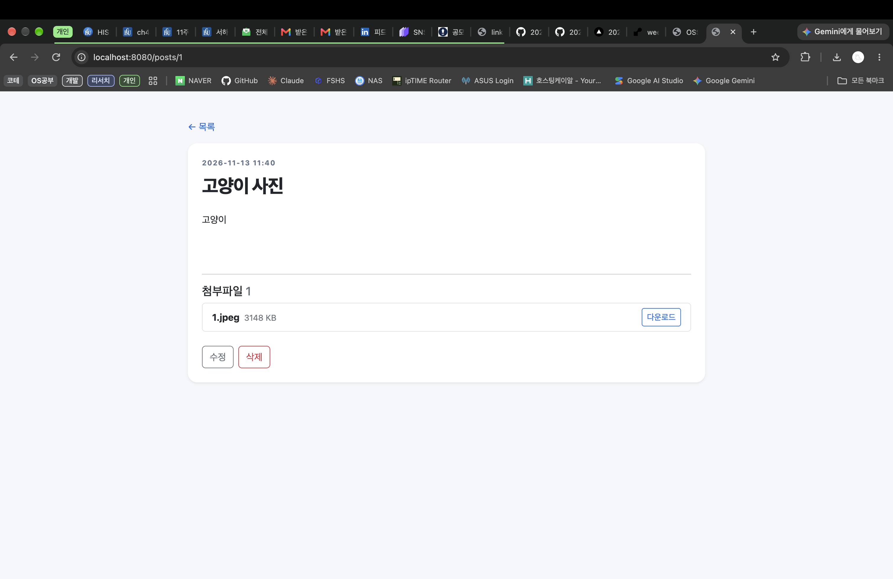
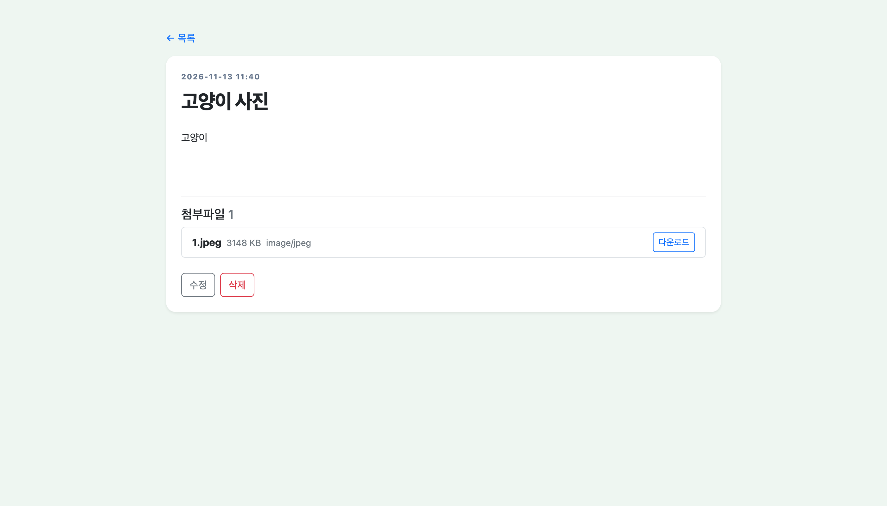

# Week 11 — Attachment Board (Student Sample)

## Project Information

### 초기 실행 화면 (Customizing 이전)

**게시글 목록** (`/posts`)

**게시글 상세 및 첨부파일** (`/posts/1`)

## Installation
1. Java 17+ 및 MariaDB 준비, `CREATE DATABASE web11 CHARACTER SET utf8mb4;`
2. 환경변수 `DB_URL`, `DB_USERNAME`, `DB_PASSWORD`를 자신의 MariaDB에 맞게 설정. 기본값은 `jdbc:mariadb://localhost:3306/web11`, `webuser`, `webpass`.
3. Gradle이 설치된 환경: `gradle bootRun` / IntelliJ: `AttachmentBoardApplication.main()` 실행.
4. 접속: http://localhost:8080/posts

## Source Code Exploration

### 1. Project Structure & Spring MVC

**Q1. PostController, PostService, PostRepository는 각각 어떤 역할을 하며, 서로 어떻게 연결되는가?**

PostController는 HTTP 요청과 응답을 처리하고, PostService와 연결된다. PostService는 대부분의 비즈니스 로직을 처리하며 PostRepository와 연결된다. PostRepository는 DB와 연결되며 DB에서 정보를 가져오거나 수정하는 역할을 한다. 예를 들어 게시글 작성은 `PostController.create()` → `PostService.create()` → `PostRepository.saveAndFlush()` 순서로 연결된다.

**Q2. 게시글 작성 시 HTML Form의 입력값과 첨부파일은 Controller에 어떻게 전달되는가?**

`form.html`의 form은 `method="post"`, `enctype="multipart/form-data"`로 `/posts`에 전송되고, `PostController.create()`가 이를 받는다. 제목과 내용은 `@ModelAttribute("postForm")`로 `PostForm` 객체에 바인딩되고, `@Valid`로 검증된 뒤 결과가 `BindingResult`에 담긴다. 첨부파일은 `name="files"`인 `multiple` input으로 전송되어 `@RequestParam(name = "files", required = false) List<MultipartFile>`로 전달된다. 그 후 검증 오류가 있으면 다시 form을 보여주고, 없으면 `PostService.create(form, files)`를 호출한다.

### 2. JPA & Entity Relationship

**Q1. Post와 Attachment Entity는 어떤 관계이며, @ManyToOne과 @OneToMany는 각각 어떤 역할을 하는가?**

`Post.java`와 `Attachment.java`는 하나의 게시글에 여러 첨부파일이 달리는 1:N 관계이다. `Attachment`의 `post` 필드에 붙은 `@ManyToOne` + `@JoinColumn(name = "post_id")`은 attachments 테이블에 FK `post_id`를 만들며, 이 쪽이 연관관계의 주인이다. `Post`의 `attachments` 필드에 붙은 `@OneToMany(mappedBy = "post")`는 외래키를 직접 관리하지 않고, Post에서 첨부파일 목록을 조회할 수 있게 해주는 역방향 매핑이다. 그래서 `Post.addAttachment()`에서 리스트에 추가하는 것과 `attachment.setPost(this)`를 함께 호출해 양쪽을 맞춰준다.

**Q2. cascade = CascadeType.ALL과 orphanRemoval = true는 어떤 역할을 하며, 실제 디스크에 저장된 파일에도 영향을 주는가?**

`Post.java`의 `attachments` 필드에 설정된 CascadeType.ALL은 모든 종류의 cascade를 적용한다는 뜻이므로 부모에 변경사항이 있으면 자식에게도 자동으로 반영된다. 그래서 `PostService.create()`에서 Post만 저장해도 Attachment가 함께 저장된다. orphanRemoval은 부모와의 연관관계가 끊겨 고아 상태가 된 자식 엔티티를 삭제한다는 것이다. 이 모든 것들은 DB 내에만 적용되므로, 디스크의 실제 파일은 `PostService.delete()`에서 `FileStorageService.deleteIfExists()`를 따로 호출해 직접 지워준다.

### 3. File Upload

**Q1. MultipartFile은 무엇이며, 업로드된 파일은 어떤 과정을 거쳐 서버에 저장되는가?**

MultipartFile은 multipart/form-data 요청으로 업로드된 파일을 Spring이 표현하는 인터페이스로, 원본 파일명, 크기, InputStream 등을 제공한다. `PostService.create()`는 각 파일을 `FileStorageService.store()`로 넘기고, `store()`는 파일명, 확장자, 크기를 검사한다. 검사를 통과하면 `UUID + 확장자`로 저장 파일명을 만들고 경로를 검증한 뒤 `Files.copy()`로 업로드 폴더에 저장하고, 파일 정보를 담은 Attachment를 반환한다. `PostService`는 이를 Post에 추가해 DB에 저장하며, 중간에 실패하면 이미 저장한 파일을 삭제한다.

**Q2. 파일을 원본 이름 대신 UUID 기반 파일명으로 저장하는 이유는 무엇인가?**

`FileStorageService.store()`에서 `UUID.randomUUID()`로 파일명을 만드는 이유는 사용자들이 같은 이름의 파일을 올려도 서로 덮어쓰지 않도록 이름 충돌을 막기 위해서이다. 또한 사용자가 정한 파일명을 그대로 경로에 쓰지 않으므로 경로 조작이나 특수문자, 한글 인코딩 문제를 피할 수 있고, 파일명을 추측해서 접근하기도 어렵다. 원본 이름은 `Attachment`의 `originalFilename`에 따로 저장해 `AttachmentController.download()`에서 다운로드할 때 사용한다.

### 4. File Download & Security

**Q1. 파일 다운로드 시 Resource, ResponseEntity, Content-Disposition은 각각 어떤 역할을 하는가?**

`AttachmentController.download()`에서 Resource는 디스크에 저장된 파일을 추상화한 객체로, `FileStorageService.load()`가 `PathResource`로 만들어 응답 본문으로 사용한다. ResponseEntity는 상태 코드, 헤더, 본문을 함께 담아 HTTP 응답 전체를 구성한다. Content-Disposition 헤더는 `attachment`로 설정되어 브라우저가 파일을 화면에 열지 않고 다운로드하게 한다. 이때 filename을 UTF-8로 인코딩한 원본 파일명으로 지정하므로 사용자는 UUID 이름이 아닌 원래 이름으로 파일을 받게 된다.

**Q2. 파일 저장 과정에서 normalize()와 startsWith()를 사용하는 이유는 무엇인가?**

`FileStorageService.store()`와 `load()`에서 normalize()와 startsWith()를 사용하는 이유는 Path Traversal 공격을 막기 위해서이다. `normalize()`는 경로 안의 `.`, `..` 같은 요소를 정리해 실제로 가리키는 경로로 바꾼다. `startsWith(uploadDir)`는 그렇게 정리된 경로가 업로드 폴더 안에 있는지 확인한다. 그래서 `../../etc/passwd` 같은 이름이 들어오더라도 업로드 폴더 밖의 파일을 쓰거나 읽을 수 없다.

## Customizing

### 1. Text: 작성 버튼 문구 변경

수정 파일: `src/main/resources/templates/posts/list.html`

목록 화면의 작성 버튼 문구를 `+ 게시글 작성`에서 `+ 새 글 쓰기`로 바꿨다.

### 2. Style: 배경색 변경

수정 파일: `src/main/resources/static/css/app.css`

`body`의 배경색을 회색빛 파란색(`#f5f7fb`)에서 연한 초록색(`#eef6f1`)으로 바꿨다.

### 3. UI/Data: 파일 타입 표시

수정 파일: `src/main/resources/templates/posts/detail.html`

변경 전에는 첨부파일 목록에 파일명과 크기만 보였다. 변경 후에는 크기 옆에 `Attachment`의 `contentType`을 함께 표시한다.

화면(템플릿, CSS)만 수정했으므로 기존 게시글 CRUD와 파일 업로드·다운로드 기능은 그대로 유지된다.

### 변경 후 실행 화면

**게시글 목록** (`/posts`): 버튼 문구와 배경색 변경

**게시글 상세** (`/posts/1`): 배경색 변경, 파일 타입(`image/jpeg`) 표시

## New Feature
## Testing & Deployment
## Weekly Review:
- 새롭게 배운 내용 3가지
- 어려웠던 점과 해결 방법
- AI 활용 내용 및 느낀 점