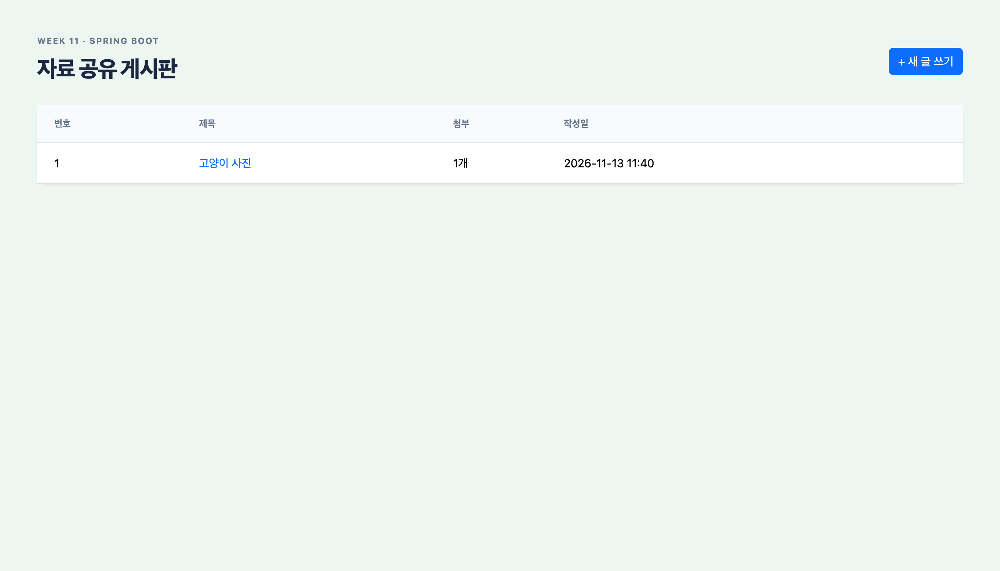
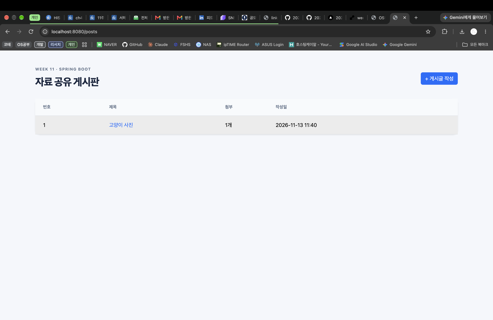
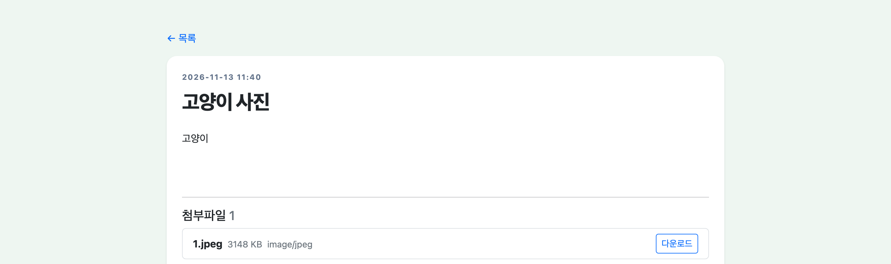
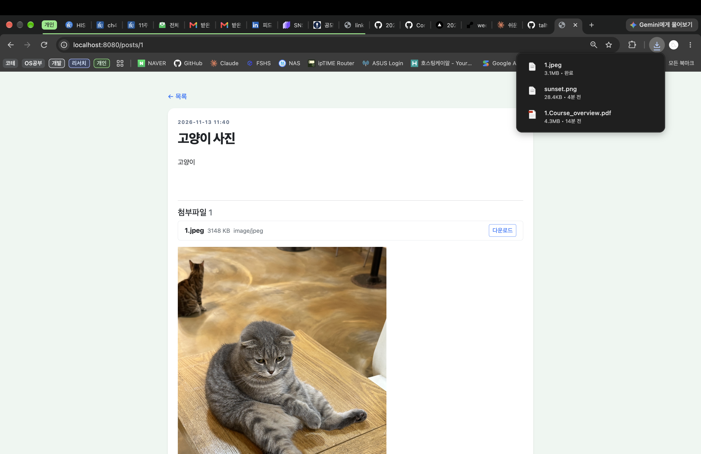
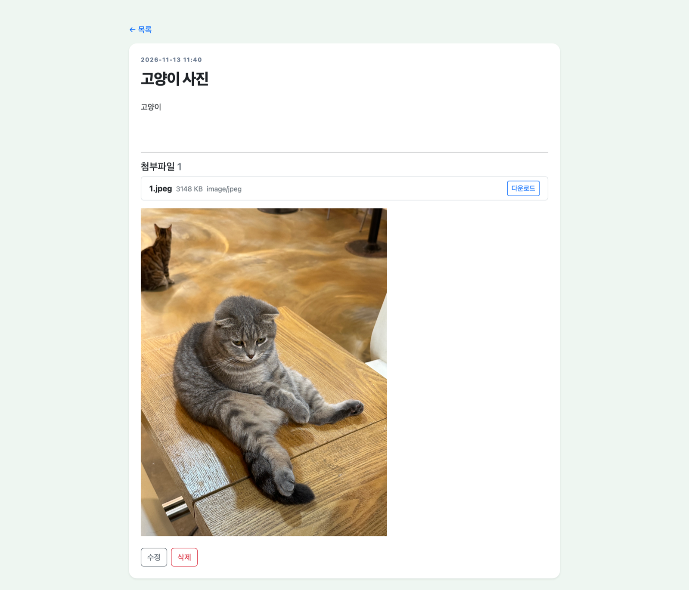

# Week 11 — Attachment Board

## Project Information

Spring Boot, Thymeleaf, JPA, MariaDB로 만든 파일 첨부 게시판이다. 게시글 CRUD와 함께 첨부파일 업로드·다운로드, 이미지 미리보기 기능을 제공한다.

- GitHub Repository URL: https://github.com/2026-2-WebService/assign11-c01-22300378
- Render Deployment URL: https://week11-sample-project.onrender.com
- 기술 스택: Java 17, Spring Boot 3.5, Spring Data JPA, Thymeleaf, Bootstrap 5, MariaDB, Docker

### 초기 실행 화면 (Customizing 이전)

**게시글 목록** (`/posts`)

**게시글 상세 및 첨부파일** (`/posts/1`)

## Installation
1. Java 17+ 및 MariaDB 준비, `CREATE DATABASE web11 CHARACTER SET utf8mb4;`
2. 환경변수 `DB_URL`, `DB_USERNAME`, `DB_PASSWORD`를 자신의 MariaDB에 맞게 설정. 기본값은 `jdbc:mariadb://localhost:3306/web11`, `webuser`, `webpass`.
3. 업로드 파일 저장 폴더는 환경변수 `UPLOAD_DIR`로 바꿀 수 있다. 기본값은 프로젝트 루트의 `uploads/`이다.
4. 실행: 터미널에서 `./gradlew bootRun`, 또는 IntelliJ에서 `AttachmentBoardApplication.main()` 실행.
5. Docker로 실행할 경우: `docker build -t attachment-board .` 후 `docker run -p 8080:8080 -e DB_URL=... -e DB_USERNAME=... -e DB_PASSWORD=... attachment-board`
6. 접속: http://localhost:8080/posts

## Source Code Exploration

### Line-by-Line 주석을 작성한 메서드

- `PostController.create()`: 게시글 작성 및 파일 업로드 요청 처리 (`src/main/java/edu/handong/web11/controller/PostController.java`)
- `FileStorageService.store()`: 파일 검증, 저장 경로 생성 및 실제 파일 저장 (`src/main/java/edu/handong/web11/service/FileStorageService.java`)
- `AttachmentController.download()`: 파일 조회 및 HTTP 다운로드 응답 처리 (`src/main/java/edu/handong/web11/controller/AttachmentController.java`)

### 1. Project Structure & Spring MVC

**Q1. PostController, PostService, PostRepository는 각각 어떤 역할을 하며, 서로 어떻게 연결되는가?**

PostController는 HTTP 요청과 응답을 처리하고, PostService와 연결된다. PostService는 대부분의 비즈니스 로직을 처리하며 PostRepository와 연결된다. PostRepository는 DB와 연결되며 DB에서 정보를 가져오거나 수정하는 역할을 한다. 예를 들어 게시글 작성은 `PostController.create()` → `PostService.create()` → `PostRepository.saveAndFlush()` 순서로 연결된다.

**Q2. 게시글 작성 시 HTML Form의 입력값과 첨부파일은 Controller에 어떻게 전달되는가?**

`form.html`의 form은 `method="post"`, `enctype="multipart/form-data"`로 `/posts`에 전송되고, `PostController.create()`가 이를 받는다. 제목과 내용은 `@ModelAttribute("postForm")`로 `PostForm` 객체에 바인딩되고, `@Valid`로 검증된 뒤 결과가 `BindingResult`에 담긴다. 첨부파일은 `name="files"`인 `multiple` input으로 전송되어 `@RequestParam(name = "files", required = false) List<MultipartFile>`로 전달된다. 그 후 검증 오류가 있으면 다시 form을 보여주고, 없으면 `PostService.create(form, files)`를 호출한다.

### 2. JPA & Entity Relationship

**Q1. Post와 Attachment Entity는 어떤 관계이며, @ManyToOne과 @OneToMany는 각각 어떤 역할을 하는가?**

`Post.java`와 `Attachment.java`는 하나의 게시글에 여러 첨부파일이 달리는 1:N 관계이다. `Attachment`의 `post` 필드에 붙은 `@ManyToOne` + `@JoinColumn(name = "post_id")`은 attachments 테이블에 FK `post_id`를 만들며, 이 쪽이 연관관계의 주인이다. `Post`의 `attachments` 필드에 붙은 `@OneToMany(mappedBy = "post")`는 외래키를 직접 관리하지 않고, Post에서 첨부파일 목록을 조회할 수 있게 해주는 역방향 매핑이다. 그래서 `Post.addAttachment()`에서 리스트에 추가하는 것과 `attachment.setPost(this)`를 함께 호출해 양쪽을 맞춰준다.

**Q2. cascade = CascadeType.ALL과 orphanRemoval = true는 어떤 역할을 하며, 실제 디스크에 저장된 파일에도 영향을 주는가?**

`Post.java`의 `attachments` 필드에 설정된 CascadeType.ALL은 모든 종류의 cascade를 적용한다는 뜻이므로 부모에 변경사항이 있으면 자식에게도 자동으로 반영된다. 그래서 `PostService.create()`에서 Post만 저장해도 Attachment가 함께 저장된다. orphanRemoval은 부모와의 연관관계가 끊겨 고아 상태가 된 자식 엔티티를 삭제한다는 것이다. 이 모든 것들은 DB 내에만 적용되므로, 디스크의 실제 파일은 `PostService.delete()`에서 `FileStorageService.deleteIfExists()`를 따로 호출해 직접 지워준다.

### 3. File Upload

**Q1. MultipartFile은 무엇이며, 업로드된 파일은 어떤 과정을 거쳐 서버에 저장되는가?**

MultipartFile은 multipart/form-data 요청으로 업로드된 파일을 Spring이 표현하는 인터페이스로, 원본 파일명, 크기, InputStream 등을 제공한다. `PostService.create()`는 각 파일을 `FileStorageService.store()`로 넘기고, `store()`는 파일명, 확장자, 크기를 검사한다. 검사를 통과하면 `UUID + 확장자`로 저장 파일명을 만들고 경로를 검증한 뒤 `Files.copy()`로 업로드 폴더에 저장하고, 파일 정보를 담은 Attachment를 반환한다. `PostService`는 이를 Post에 추가해 DB에 저장하며, 중간에 실패하면 이미 저장한 파일을 삭제한다.

**Q2. 파일을 원본 이름 대신 UUID 기반 파일명으로 저장하는 이유는 무엇인가?**

`FileStorageService.store()`에서 `UUID.randomUUID()`로 파일명을 만드는 이유는 사용자들이 같은 이름의 파일을 올려도 서로 덮어쓰지 않도록 이름 충돌을 막기 위해서이다. 또한 사용자가 정한 파일명을 그대로 경로에 쓰지 않으므로 경로 조작이나 특수문자, 한글 인코딩 문제를 피할 수 있고, 파일명을 추측해서 접근하기도 어렵다. 원본 이름은 `Attachment`의 `originalFilename`에 따로 저장해 `AttachmentController.download()`에서 다운로드할 때 사용한다.

### 4. File Download & Security

**Q1. 파일 다운로드 시 Resource, ResponseEntity, Content-Disposition은 각각 어떤 역할을 하는가?**

`AttachmentController.download()`에서 Resource는 디스크에 저장된 파일을 추상화한 객체로, `FileStorageService.load()`가 `PathResource`로 만들어 응답 본문으로 사용한다. ResponseEntity는 상태 코드, 헤더, 본문을 함께 담아 HTTP 응답 전체를 구성한다. Content-Disposition 헤더는 `attachment`로 설정되어 브라우저가 파일을 화면에 열지 않고 다운로드하게 한다. 이때 filename을 UTF-8로 인코딩한 원본 파일명으로 지정하므로 사용자는 UUID 이름이 아닌 원래 이름으로 파일을 받게 된다.

**Q2. 파일 저장 과정에서 normalize()와 startsWith()를 사용하는 이유는 무엇인가?**

`FileStorageService.store()`와 `load()`에서 normalize()와 startsWith()를 사용하는 이유는 Path Traversal 공격을 막기 위해서이다. `normalize()`는 경로 안의 `.`, `..` 같은 요소를 정리해 실제로 가리키는 경로로 바꾼다. `startsWith(uploadDir)`는 그렇게 정리된 경로가 업로드 폴더 안에 있는지 확인한다. 그래서 `../../etc/passwd` 같은 이름이 들어오더라도 업로드 폴더 밖의 파일을 쓰거나 읽을 수 없다.

## Customizing

### 1. Text: 작성 버튼 문구 변경

수정 파일: `src/main/resources/templates/posts/list.html`

목록 화면의 작성 버튼 문구를 `+ 게시글 작성`에서 `+ 새 글 쓰기`로 바꿨다.

### 2. Style: 배경색 변경

수정 파일: `src/main/resources/static/css/app.css`

`body`의 배경색을 회색빛 파란색(`#f5f7fb`)에서 연한 초록색(`#eef6f1`)으로 바꿨다.

### 3. UI/Data: 파일 타입 표시

수정 파일: `src/main/resources/templates/posts/detail.html`

변경 전에는 첨부파일 목록에 파일명과 크기만 보였다. 변경 후에는 크기 옆에 `Attachment`의 `contentType`을 함께 표시한다.

화면(템플릿, CSS)만 수정했으므로 기존 게시글 CRUD와 파일 업로드·다운로드 기능은 그대로 유지된다.

### 변경 후 실행 화면

**게시글 목록** (`/posts`): 버튼 문구와 배경색 변경

**게시글 상세** (`/posts/1`): 배경색 변경, 파일 타입(`image/jpeg`) 표시

## New Feature

### 이미지 미리보기 (Image Preview)

게시글 상세 화면에서 첨부된 이미지(jpg, jpeg, png, gif)를 바로 볼 수 있게 했다.

**1. 미리보기 API: `AttachmentController.imagePreview()`** (`GET /attachments/{id}/view`)

- `AttachmentRepository.findById()`로 첨부파일 정보를 조회하고, 없으면 404를 반환한다.
- `FileStorageService.load()`로 실제 파일을 `Resource`로 가져온다. 이때 경로가 업로드 폴더 밖이거나 디스크에 파일이 없으면 404를 반환한다.
- 응답의 `Content-Type`은 업로드 시 확장자로 정해 DB에 저장한 `contentType`(예: `image/jpeg`)을 사용한다.
- `Content-Disposition`을 `inline`으로 보내 브라우저가 파일을 다운로드하지 않고 화면에 바로 표시하게 했다. 다운로드 API는 `attachment`를 쓰는 것과 차이가 있다.

**2. 화면: `detail.html`**

- 첨부파일 목록을 `th:each`로 돌면서 `th:if="${#strings.startsWith(file.contentType, 'image/')}"`로 이미지 파일만 골라낸다.
- 이미지 파일은 ``로 미리보기를 표시한다.
- PDF, TXT 등 이미지가 아닌 파일은 미리보기 없이 기존 다운로드 버튼만 표시된다.

**3. 오류 처리**

- 존재하지 않는 첨부파일 ID(`/attachments/99999/view`): 404
- 숫자가 아닌 잘못된 ID(`/attachments/abc/view`): 400
- DB에는 정보가 있지만 디스크에 파일이 없는 경우: `FileStorageService.load()`에서 404

## Testing & Deployment

### Local Testing

테스트 스크린샷은 `results/` 폴더에 저장했다.

**01. Sample Project 초기 실행 화면 (Customizing 이전)**

**02. 파일 업로드 성공 화면**

이미지 파일(`1.jpeg`)을 첨부해 게시글을 작성했고, 상세 화면의 첨부파일 목록에 파일명, 크기, 타입이 표시되었다.

**03. 파일 다운로드 성공 화면**

**04. 이미지 미리보기 실행 화면**

첨부한 이미지 파일(`1.jpeg`)이 상세 화면에 미리보기로 표시된다. 이미지가 아닌 파일(PDF, TXT)은 미리보기 없이 다운로드 버튼만 표시된다.

**CRUD 및 오류 처리 테스트**

- 작성: 파일 2개를 첨부한 게시글 작성 후 상세 화면으로 이동(302 → `/posts/4`)
- 수정: 제목과 내용을 수정한 뒤 상세 화면에 변경된 제목이 표시됨
- 삭제: 삭제 후 목록으로 이동하고, 같은 게시글 조회 시 404
- 다운로드: 받은 파일이 업로드한 원본 파일과 동일함(SHA-1 일치), `Content-Disposition: attachment`로 원본 파일명 유지
- 입력값 검증: 제목을 비우고 작성하면 폼으로 돌아가 "공백일 수 없습니다" 오류 메시지 표시
- 존재하지 않는 게시글(`/posts/99999`): 404
- 존재하지 않는 첨부파일 다운로드·미리보기(`/attachments/99999/download`, `/attachments/99999/view`): 404
- 잘못된 ID 형식(`/posts/abc`, `/attachments/abc/view`): 400

### Deployment

- GitHub(조직): https://github.com/2026-2-WebService/assign11-c01-22300378.git
- GitHub(개인): https://github.com/ggm77/week11_sample_project.git
- Render Deployment URL: https://week11-sample-project.onrender.com

## Weekly Review

### 새롭게 배운 내용 3가지

1. **멀티파트 파일 업로드 흐름**: form에 `enctype="multipart/form-data"`를 지정하면 파일이 `MultipartFile`로 컨트롤러에 전달되고, 서비스에서 검증한 뒤 `Files.copy()`로 디스크에 저장한다는 흐름을 알게 되었다.
2. **JPA 연관관계와 실제 파일의 분리**: `cascade`와 `orphanRemoval`은 DB의 엔티티에만 적용되기 때문에, 게시글을 삭제할 때 디스크의 파일은 따로 지워야 한다는 점을 배웠다.
3. **파일 응답과 보안**: `Resource`, `ResponseEntity`, `Content-Disposition`으로 다운로드(`attachment`)와 미리보기(`inline`) 응답을 다르게 만들 수 있고, `normalize()`와 `startsWith()`로 Path Traversal을 막는 방법을 배웠다.

### 어려웠던 점과 해결 방법

- **이미지 파일만 골라 미리보기 표시하기**: 첨부파일에는 PDF, TXT도 있어서 모든 파일에 ``를 붙일 수는 없었다. DB에 저장된 `contentType`이 `image/`로 시작하는지 `th:if`로 검사해 이미지 파일에만 미리보기를 표시했다.

### AI 활용 내용 및 느낀 점

**활용 내용** (Claude Code 사용)

- 직접 작성한 주석 중 잘못된 설명 검토 및 수정
- `@RequestParam`과 `@RequestPart`의 차이, `BindingResult`의 역할 등 코드 이해를 위한 질문

**느낀 점**

주석을 하나 하나 작성하면서 내가 못봤던 부분이 보이기 시작하고, 그걸 AI에게 물어보니 공부가 더 잘되는 느낌이 들었다.